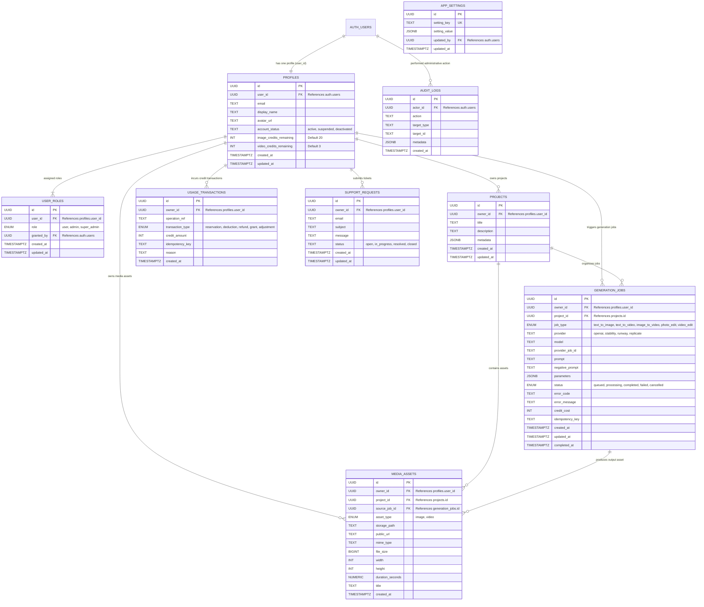

# Flow AI Studio — Entity Relationship Diagram (ERD)

This document describes the complete relational database model designed for **Flow AI Studio**, implemented in PostgreSQL on Supabase with Row Level Security (RLS).

## Mermaid ER Diagram

## Schema Relationships Explained

1. **User Identity & Profile (`auth.users` -> `profiles`)**:
   - Each authenticated Supabase user has a single corresponding profile created atomically via a PostgreSQL trigger `handle_new_user()`.
   - On signup, initial quota (20 image credits, 3 video credits) is safely assigned.

2. **Role-Based Access Control (`profiles` -> `user_roles`)**:
   - Roles include `user`, `admin`, and `super_admin`.
   - A normal user cannot modify their role. Only `super_admin` possesses permission to modify user role assignments.

3. **Workspace Organization (`profiles` -> `projects`)**:
   - Users can create multiple projects to organize generation jobs and media assets.

4. **Asynchronous Jobs (`generation_jobs` -> `media_assets`)**:
   - AI generation processes are recorded as `generation_jobs`.
   - Once a job transitions from `queued` / `processing` to `completed`, output artifacts are stored in private Supabase storage and indexed in `media_assets`.

5. **Quota Accounting & Idempotency (`profiles` -> `usage_transactions`)**:
   - Credit reservations and deductions are atomic using `deduct_user_credits()`.
   - Idempotency keys prevent duplicate deductions on retries or network interruptions.
   - If an AI provider returns an error, credits are automatically refunded.

6. **System Administration & Auditing (`app_settings`, `audit_logs`)**:
   - Administrative flags (maintenance mode, feature toggles, branding, credit limits) are protected by Row Level Security.
   - High-privilege administrative actions are recorded in `audit_logs`.
